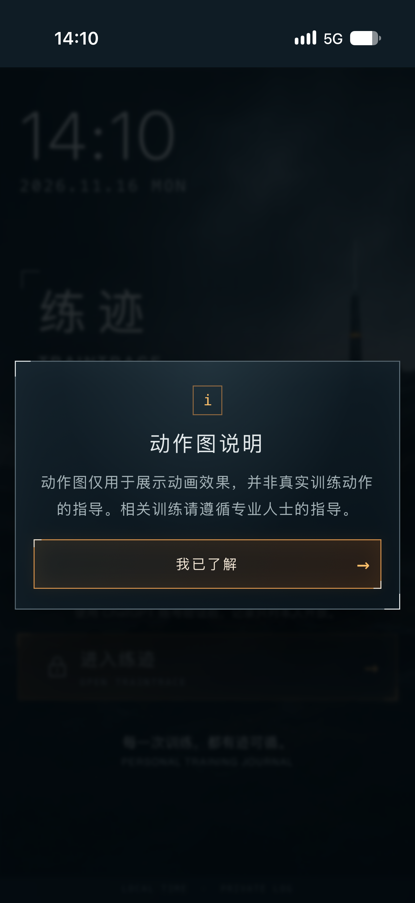
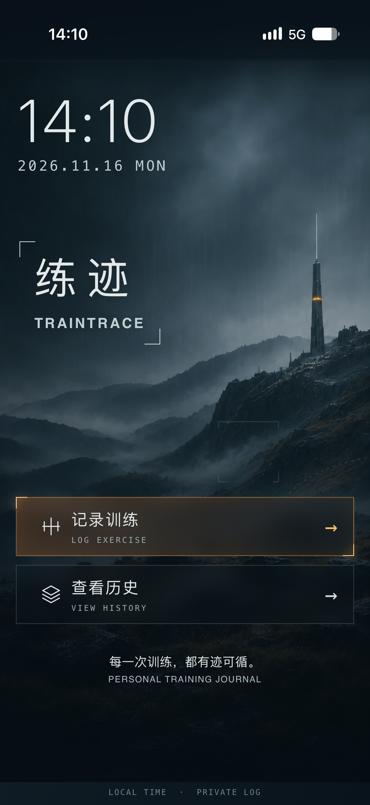
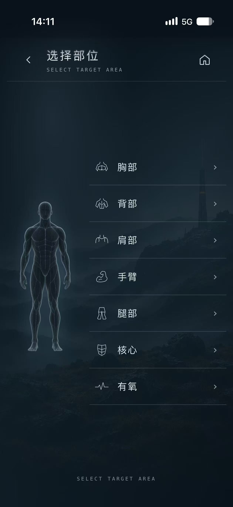

# TRAINTRACE V3.5

## Why did I make this?

纯粹的记录，不带脑子的记录。同时打通gpt的访问，让ai帮助我统计分析我的训练。

快捷，不装app，没有隐私监控，没有广告，没有订阅。

功能极端纯粹。就只想做好一件事。

推荐用浏览器打开后添加到桌面，就能有类App的使用体验了。

## 项目简介

TRAINTRACE（练迹）是一个独立的个人训练记录项目，面向个人学习、非商业创作和自行部署。它最初作为 ChatGPT Sites 私有站点开发与托管；本目录提供源码和插件技能，供检查与改造。

这份源码不是通用的一键安装包。它仍依赖原实现中的 ChatGPT Sites 身份、D1 数据库、Cloudflare Worker/Vinext 运行环境和 Sites MCP 集成。欢迎在理解这些依赖后改造为自己的服务器部署；独立托管尚未验证，适配步骤见 [DEPLOY.md](DEPLOY.md)。项目与 OpenAI 无隶属关系，也不表示 OpenAI 对项目或内容的认可。

## 手机端实拍

从首页开始记录，选择训练部位和动作，再逐组填写。以下截图以自重引体向上为例，组次尚未填写。

<table>
  <tr>
    <td width="50%" valign="top"><strong>入口提示</strong> 进入站点时先阅读动作图说明。AI 动作图仅供界面展示，请勿模仿。 </td>
    <td width="50%" valign="top"><strong>首页</strong> 从「记录训练」开始记录，或从「查看历史」回看已保存的训练。 </td>
  </tr>
  <tr>
    <td width="50%" valign="top"><strong>选择部位</strong> 按胸、背、肩、手臂、腿、核心或有氧进入相应动作列表。 </td>
    <td width="50%" valign="top"><strong>逐组记录</strong> 填写每组次数，可新增空白组或复制上一组，记录完后点击「结束动作」。 </td>
  </tr>
</table>

## 主要功能

- 按胸、背、肩、臂、腿、核心和有氧等部位选择预设动作，或创建个人动作。
- 按动作类型逐组记录重量、次数、辅助重量、时长或距离。
- 为单项动作记录主观疲劳感；其数值是个人感受计数，没有固定上限，不代表客观疲劳或身体恢复状态。
- 按设备本地日期查看训练历史，并导出 JSON 或 CSV。
- 支持离线暂存与恢复联网后的同步。服务端会按记录版本处理冲突；同一账号的新记录会话接管后，旧会话不得继续写入。离线内容留在原设备，不会自动迁移到另一台设备。
- 可通过站点的只读 MCP 按日期范围，或在用户明确要求时查询全部历史中的已完成记录，供 ChatGPT 总结或比较；插件不包含训练记录的创建、编辑或删除工具。AI 回答仍应核对原始记录。

已保存的记录保留在部署者的数据库中。本版本没有自动到期策略或用于删除已保存记录的界面。如需清除历史数据，请由部署者通过其托管平台或数据库的管理方式处理。

## 动作示意与训练安全

动作插图和动画由 AI 生成，仅用于界面展示。请勿模仿图中动作，实际训练请遵循专业人士指导。

## ChatGPT Sites 使用责任

原版使用 ChatGPT Sites 托管。Sites 的站点作者仍负责审查站点功能和访客提交内容、确认拥有发布内容所需权利、选择适当的访问范围，并遵守适用法律、Sites 条款及 OpenAI 使用政策。发布前请检查站点实际访问设置、收集的信息与存储行为。Sites 的功能、可用权限、配额和条款可能变化，应以账户当前显示和官方说明为准。

开始部署或分享前，请阅读：[ChatGPT Sites 条款](https://openai.com/policies/chatgpt-sites-terms/)、[Sites 作者责任](https://help.openai.com/en/articles/20001337-understanding-responsibilities-for-your-chatgpt-sites)、[创建、使用与分享 Sites](https://help.openai.com/en/articles/20001339-creating-and-using-chatgpt-sites)、[OpenAI 使用政策](https://openai.com/policies/usage-policies)及[隐私与数据保护说明](https://help.openai.com/en/articles/20001340-complying-with-data-protection-laws-for-chatgpt-sites)。

## 许可

本项目按非商业许可提供。允许的范围、非商业边界及在 GitHub 以外再分发所需的授权见根目录 [LICENSE](LICENSE)。第三方代码和资源继续适用各自许可，见 [THIRD_PARTY_NOTICES.md](THIRD_PARTY_NOTICES.md)；独立创作的新增内容由其作者另行决定授权方式。请不要把本项目许可理解为对任何第三方素材的额外授权。
